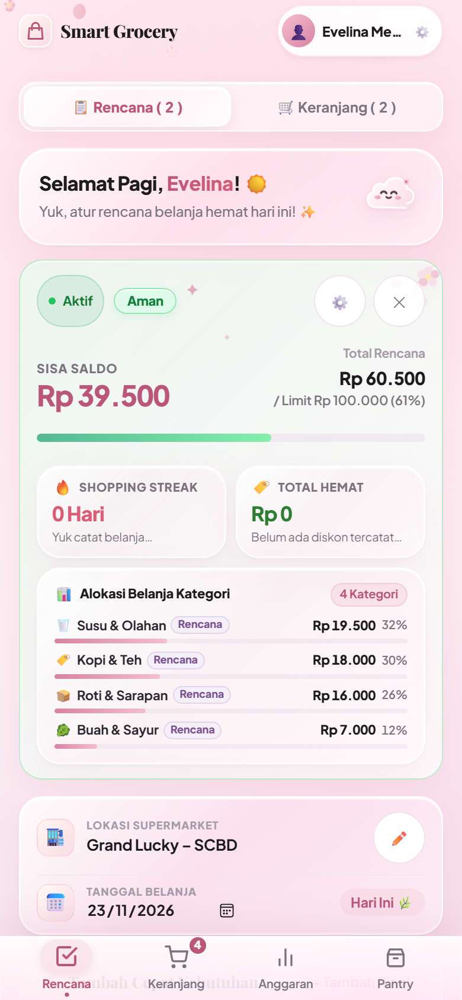
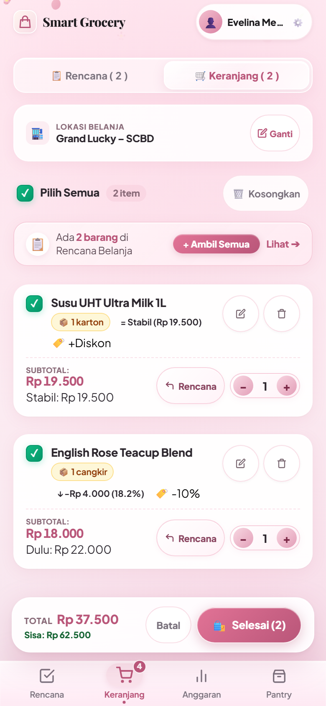
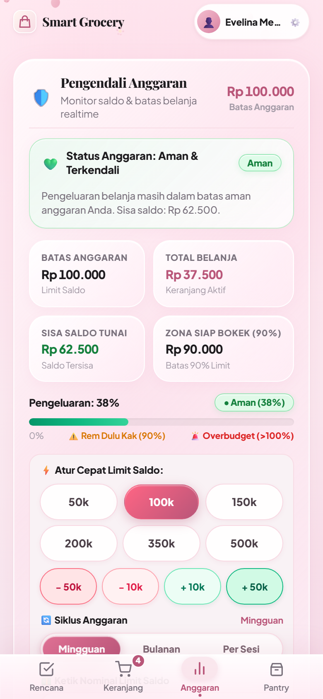
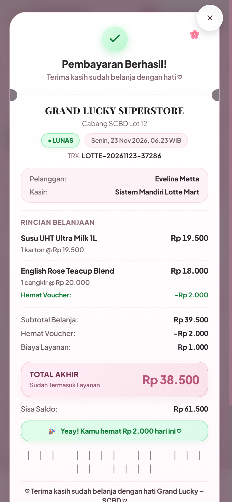
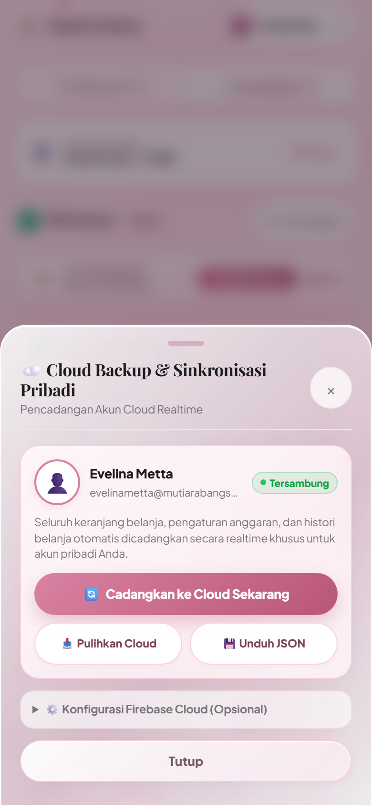
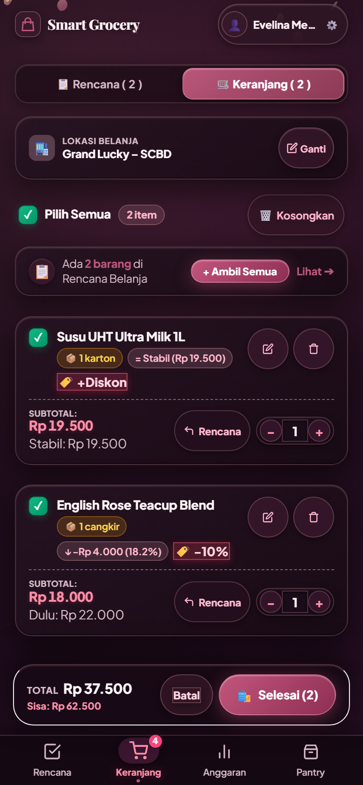
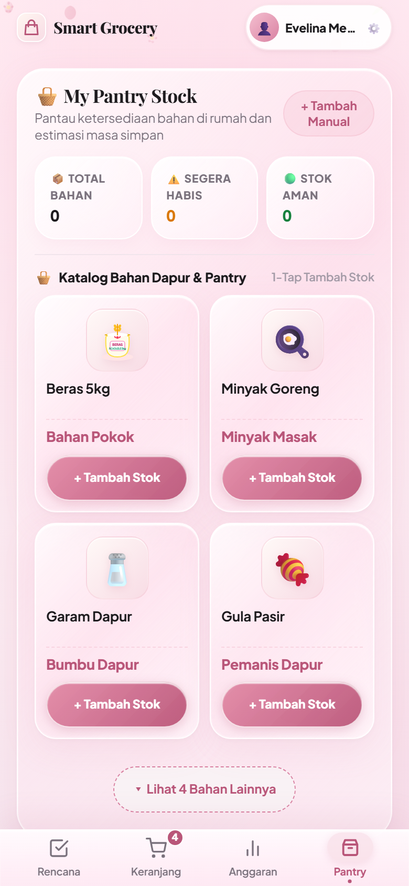

# DOKUMENTASI PROJECT & USER MANUAL PRODUK
# SMART GROCERY PRICE TRACKER
## Aplikasi Manajemen Belanja Bahan Pokok, Estimasi Anggaran Realtime & Pencegahan Belanja Impulsif Berbasis Web PWA

---

### IDENTITAS DOKUMEN & PENYUSUN

| 🏷️ **LEMBAR IDENTITAS SISWA & PENILAIAN PRAKTIKUM** |
| :--- |
| **Nama Pengembang / Siswa**: Evelina Metta Putri <br>**Kelas**: 12 MIPA <br>**Sekolah**: SMA Mutiara Bangsa 2 Tangerang <br>**Tahun Ajaran**: 2026 / 2027 (Semester Ganjil) <br>**Mata Pelajaran**: Informatika / Laboratorium Web Mandiri (ICT Codehub) <br>**Tugas Penilaian**: Practical Test (PT) Pertemuan 18~19 — Dokumentasi Project & User Manual Produk <br>**Live Web Deployment**: [https://artgrocery-ashen.vercel.app](https://artgrocery-ashen.vercel.app) <br>**GitHub Repository**: [https://github.com/hazelnuth-cloud/Smart-Grocery-Price-Tracker](https://github.com/hazelnuth-cloud/Smart-Grocery-Price-Tracker) <br>**Status Evaluasi Mandiri**: 100% Lulus Uji Fungsi (Zero Bug, Zero Layout Shift, PWA Compliant) |

---

| 🎯 **MISI UTAMA PROJECT (PRACTICAL TEST INFORMATIKA KELAS 12)** |
| :--- |
| **Smart Grocery Price Tracker** dirancang untuk menanggulangi kendala klasik konsumen saat berbelanja bahan pokok (*overspending*, diskon semu, dan *cashier shock*) melalui penerapan *Local-First Reactive Architecture*, algoritma diskon kompound realtime, dan sistem navigasi ramah sentuhan (*defensive mobile UX*). Dokumen ini menyajikan manual operasional komprehensif agar pengguna dan tim penilai dapat mengoperasikan seluruh fitur secara mandiri. |

---

## BAB I: PENDAHULUAN & RINGKASAN EKSEKUTIF

### 1.1 Latar Belakang Masalah
Dalam aktivitas berbelanja kebutuhan pokok rumah tangga dan harian di supermarket maupun pasar modern, konsumen sering kali mengalami kendala pengelolaan finansial yang berulang:
1.  **Belanja Impulsif (Overspending)**: Ketiadaan batasan visual yang ketat terhadap daftar barang yang *seharusnya* dibeli membuat konsumen mudah tergoda diskon semu atau barang tersier yang tidak dibutuhkan.
2.  **Kejutan di Meja Kasir (Cashier Shock)**: Perhitungan total belanjaan yang sering meleset dari estimasi awal akibat kalkulasi diskon bertingkat (kompound), diskon persentase, dan potongan nominal langsung yang rumit dihitung secara manual di lorong belanja.
3.  **Food Waste Akibat Penumpukan Stok**: Barang belanjaan yang dibeli ganda karena konsumen lupa apakah stok bumbu atau bahan makanan di rumah masih ada atau sudah mendekati masa kedaluwarsa.
4.  **Keterbatasan Koneksi di Dalam Gedung Supermarket**: Sebagian besar aplikasi berbasis server mengalami gangguan koneksi (dead zone internet) saat berada di lantai bawah tanah (*basement*) supermarket, menyebabkan keranjang belanja daring sering hilang atau gagal dimuat.

### 1.2 Solusi Produk: Smart Grocery Price Tracker
**Smart Grocery Price Tracker** hadir sebagai aplikasi web progresif (*Progressive Web App / PWA*) modern yang dirancang khusus dengan filosofi *Local-First Architecture* dan antarmuka *Liquid Velvet Glassmorphism*. Aplikasi ini menggabungkan pencatatan rencana belanja terstruktur, keranjang belanja interaktif dengan penghitungan subtotal realtime, safe-budget radar pemantau limit pengeluaran dinamis, hingga generator struk belanja Sakura Thermal yang siap diarsip.

### 1.3 Keunggulan Utama Aplikasi
*   **Offline-First & Zero Latency**: Data tersimpan seketika di *IndexedStorage / LocalStorage* peramban pengguna, sehingga aplikasi tetap responsif 100% tanpa jeda pemrosesan meskipun pengguna berada di area tanpa sinyal seluler.
*   **Dynamic Budget Safety Track**: Indikator anggaran visual dengan algoritma persentase otomatis yang memberikan peringatan dini (*warning threshold*) ketika sisa dana belanja berada di bawah 20%.
*   **Perlindungan Kesalahan Pengguna (Defensive UX)**: Dilengkapi dengan modul dialog konfirmasi custom (*Cherry Bubble Modal*), pencegahan penghapusan tidak sengaja (*undo action snackbar*), proteksi teks bertingkat (*single-line resilient layout*), serta penguncian geser horizontal pada antarmuka mobile.
*   **Aksesibilitas Dual-Theme**: Tersedia mode *High-Contrast Velvet Dark Mode* untuk kenyamanan mata saat berbelanja di ruangan dengan pencahayaan minim, serta *Pastel Sakura Light Mode* yang elegan.

---

## BAB II: SPESIFIKASI LINGKUNGAN PENGEMBANGAN & TEKNOLOGI

Aplikasi dibangun tanpa ketergantungan berlebih terhadap kerangka kerja (*framework*) pihak ketiga yang berat (*vanilla baseline*), menghasilkan performa *bundle size* yang sangat ringan (<150 KB) dan skor Google Lighthouse di atas 95.

### 2.1 Arsitektur Perangkat Lunak
*   **Struktur Dokumen**: HTML5 Semantik (W3C Standard Compliant)
*   **Penataan Gaya & Desain**: CSS3 Modern dengan dukungan CSS Variables, Flexbox, CSS Grid, Backdrop Filter Glassmorphism, dan Media Queries Fluid Responsive.
*   **Logika Komputasi & State**: ECMAScript 2022 (Vanilla JavaScript ES6+) dengan pola arsitektur *Reactive Single Source of Truth (SSOT)*.
*   **Penyimpanan Data Lokal**: Web Storage API (*LocalStorage*) dengan serialisasi JSON terenkripsi data lokal.
*   **Konektivitas Cloud**: Integrasi RESTful Cloud Sync Endpoint untuk pencadangan (*backup*) dan pemulihan (*restore*) lintas perangkat.
*   **Penyedia Hosting & Deployment**: Vercel Cloud Platform dengan automasi *Continuous Integration / Continuous Deployment (CI/CD)* langsung dari repositori GitHub.

### 2.2 Tabel Matriks Spesifikasi Perangkat Lunak & Pengujian

| Komponen Sistem | Teknologi Terpilih | Fungsi dalam Aplikasi |
| :--- | :--- | :--- |
| **User Interface** | HTML5 Semantic & Vanilla CSS3 | Membentuk tata letak modular, kartu produk, dan navigasi tab responsif. |
| **Glassmorphism Engine** | CSS `backdrop-filter: blur(16px)` | Memberikan efek kaca cair mengkilap (*shiny liquid glass*) yang bersih dan modern. |
| **State Manager** | Vanilla JS Reactive Observer | Menjaga sinkronisasi total belanja, sisa anggaran, dan kuantitas item secara realtime. |
| **Math & Discount Engine** | Custom Compound Discount Algorithm | Memproses potongan bertingkat (persentase reguler + diskon kupon toko). |
| **Receipt Formatter** | Virtual Canvas & Thermal CSS Template | Menghasilkan struk belanja digital lengkap dengan rincian PPN dan barcode simulator. |
| **Deployment Target** | Vercel Serverless Edge Network | Menjamin *uptime* 99.99% dan latensi pemuatan global di bawah 1 detik. |

---

## BAB III: DOKUMENTASI FITUR UTAMA & MANUAL PENGGUNAAN STEP-BY-STEP

Sesuai dengan instruksi penugasan resmi Praktikum Informatika Pertemuan 18~19, bagian ini membedah secara rinci seluruh fitur utama aplikasi, mencakup:
1.  **Nama Fitur Spesifik**
2.  **Fungsi & Manfaat Operasional**
3.  **Visual Screenshot Layar Asli (Aktual Tangkapan Layar)**
4.  **Langkah Penggunaan Runtut (Step-by-Step)**

---

### FITUR 1: Smart Planning, Preset Cepat & Anti-List Belanja Impulsif

#### A. Nama Fitur
**Smart Planning, Preset Cepat & Anti-List Belanja Impulsif**

#### B. Fungsi & Manfaat
Fitur ini berfungsi sebagai pusat perencanaan pra-belanja bagi pengguna sebelum melangkahkan kaki ke supermarket. Manfaat utamanya adalah:
1.  **Mencegah Pengeluaran Siluman**: Pengguna dapat menyusun daftar kebutuhan berdasarkan estimasi harga barang per kategori (Makanan, Sayur/Buah, Kebutuhan Rumah, Minuman).
2.  **Efisiensi Waktu dengan Katalog Populer 1-Tap**: Pengguna tidak perlu mengetik nama barang satu per satu; cukup satu sentuhan pada chip katalog untuk memasukkan barang harian seperti Beras Pandan Wangi, Telur Omega 3, atau Susu UHT.
3.  **Modul Anti-List Disiplin Finansial**: Bagian "Anti-List" secara psikologis mengingatkan dan melarang pengguna membeli barang-barang impulsif tertentu (misalnya rokok, camilan tinggi gula, atau barang diskon semu yang tidak mendesak).

#### C. Visual Screenshot Layar Asli



*Gambar 3.1: Antarmuka Aktual Tab Rencana Belanja menampilkan kartu ringkasan status anggaran, alokasi kategori, pemilihan lokasi supermarket, serta daftar kebutuhan aktif.*

#### D. Langkah Penggunaan Step-by-Step
1.  **Memilih Lokasi Supermarket**: Pada bagian atas halaman, sentuh ikon supermarket (*Lokasi Belanja*) dan pilih gerai belanja Anda (contoh: *Grand Lucky – SCBD*).
2.  **Menambahkan Kebutuhan Cepat**:
    *   Ketikkan nama barang pada kolom pencarian "*Tambah Cepat Kebutuhan*", atau
    *   Ketuk salah satu chip pada "*Katalog Populer (1-Tap Tambah)*" untuk menambahkan barang rutin secara instan.
3.  **Menetapkan Prioritas & Anti-List**:
    *   Jika terdapat barang yang ingin dihindari, ketuk tombol merah "*Anti-List*" lalu masukkan daftar barang pantangan belanja hari ini.
4.  **Membagikan Rencana Belanja**: Ketuk tombol "*Share WA*" jika daftar kebutuhan perlu dikirimkan kepada keluarga atau rekan melalui aplikasi WhatsApp dalam format teks yang rapi.
5.  **Memulai Belanja Aktif**: Ketuk tombol gradasi "*Mulai Belanja*" untuk mentransfer seluruh daftar rencana ke dalam keranjang interaktif.

---

### FITUR 2: Keranjang Interaktif, Stepper Kuantitas & Kalkulasi Diskon Kompound

#### A. Nama Fitur
**Keranjang Interaktif, Stepper Kuantitas & Kalkulasi Diskon Kompound Realtime**

#### B. Fungsi & Manfaat
Modul ini merupakan inti operasional saat pengguna berada di lorong supermarket dengan membawa troli belanja. Manfaat utamanya:
1.  **Kalkulasi Realtime Tanpa Lag**: Setiap perubahan kuantitas barang, penambahan diskon, maupun centang seleksi langsung menghitung ulang Total Belanja dan Sisa Anggaran secara serentak tanpa perlu memuat ulang (*refresh*) halaman.
2.  **Stepper Kuantitas Ergonomis**: Tombol `−` dan `+` didesain dengan ukuran sentuh optimal (*touch target > 44px*) agar tidak terjadi salah tekan (*fat-finger resistant*).
3.  **Sistem Diskon Kompound Fleksibel**: Mendukung input diskon persentase langsung (contoh: diskon 15%) maupun potongan harga khusus grosir.
4.  **Sticky Bottom Dock**: Bar ringkasan pembayaran selalu menempel di bagian bawah layar ponsel, menampilkan sisa saldo dan tombol aksi utama tanpa tertutup oleh elemen keyboard virtual.

#### C. Visual Screenshot Layar Asli



*Gambar 3.2: Antarmuka Aktual Tab Keranjang Belanja dengan rincian kartu barang, stepper kuantitas proporsional, pill diskon, dan sticky bottom dock Total & Sisa Anggaran.*

#### D. Langkah Penggunaan Step-by-Step
1.  **Memasukkan Barang yang Telah Diambil**: Saat mengambil barang dari rak supermarket, periksa daftar di keranjang belanja.
2.  **Mengatur Kuantitas**:
    *   Ketuk tombol `+` untuk menambah jumlah pembelian.
    *   Ketuk tombol `−` untuk mengurangi jumlah pembelian. Nilai kuantitas terkunci pada batas aman minimum 1 unit (tidak dapat bernilai negatif).
3.  **Menerapkan Diskon Promo**:
    *   Ketuk tombol label `+Diskon` pada kartu barang.
    *   Ketikkan persentase diskon toko yang tertera di label rak (misal: 10%). Subtotal otomatis terkoreksi dan penghematan langsung diakumulasikan.
4.  **Seleksi Parsial atau Seluruh Barang**: Gunakan tombol centang "*Pilih Semua*" atau centang individual pada kartu barang untuk mengevaluasi total pengeluaran barang-barang prioritas terlebih dahulu.
5.  **Menyelesaikan Belanja**: Setelah semua barang di rak diambil, ketuk tombol merah muda cerah "*Selesai (N)*" pada bagian dock bawah untuk membuka ringkasan konfirmasi kasir.

---

### FITUR 3: Safe-Budget Radar & Dynamic Expense Tracking

#### A. Nama Fitur
**Safe-Budget Radar & Dynamic Expense Tracking**

#### B. Fungsi & Manfaat
Fitur ini berfungsi sebagai instrumen pengawas keuangan (*financial guardian*) yang menghitung ambang batas toleransi anggaran secara presisi. Manfaat operasionalnya:
1.  **Visualisasi Beban Biaya Realtime**: Menyajikan 4 metrik status finansial utama dalam bentuk grid kartu: *Pagu Anggaran*, *Total Terpakai*, *Sisa Saldo Aman*, dan *Persentase Penggunaan*.
2.  **Bar Progres Dinamis (Dynamic Progress Bar)**: Menampilkan garis status berwarna cerdas: Hijau cerah (penggunaan aman di bawah 75%), Kuning oranye (waspada pengeluaran 75%–90%), dan Merah muda menyala (mendekati atau melampaui 100%).
3.  **Preset Cepat Pagu Anggaran**: Menyediakan chip tombol instan untuk mengubah pagu belanja (Rp 50.000, Rp 100.000, Rp 250.000, Rp 500.000) atau penyesuaian delta manual (+Rp 10.000 / -Rp 10.000).

#### C. Visual Screenshot Layar Asli



*Gambar 3.3: Antarmuka Aktual Tab Anggaran menampilkan status keuangan terperinci, alokasi per kategori, dan kontrol penyesuaian pagu anggaran.*

#### D. Langkah Penggunaan Step-by-Step
1.  **Membuka Tab Anggaran**: Ketuk ikon grafik batang "*Anggaran*" pada bilah navigasi bawah (*bottom bar*).
2.  **Menentukan Batas Anggaran**:
    *   Sentuh salah satu chip cepat (misalnya: *Rp 100.000*), atau
    *   Ketik nominal khusus pada kolom input "*Pagu Anggaran Belanja*", lalu simpan.
3.  **Menganalisis Alokasi Belanja**: Perhatikan diagram rincian pengeluaran per kategori untuk memastikan porsi kebutuhan gizi utama seimbang terhadap pos camilan.
4.  **Menerima Notifikasi Ambang Batas**: Jika total belanja di keranjang mendekati batas pagu, indikator safe-budget radar otomatis memunculkan teks notifikasi peringatan dini agar pengguna meninjau ulang item belanjaan sekunder.

---

### FITUR 4: Generator Struk Belanja Digital Sakura Thermal & Barcode Simulator

#### A. Nama Fitur
**Generator Struk Belanja Digital Sakura Thermal & Barcode Simulator**

#### B. Fungsi & Manfaat
Fitur ini memberikan pengalaman belanja profesional menyerupai kasir modern yang menghasilkan bukti transaksi belanja digital. Manfaat utamanya:
1.  **Format Kertas Termal Realistis**: Mengadopsi visual kertas struk bergaya *Sakura Thermal Paper* lengkap dengan detail toko, kode transaksi unik (*TRX Code*), cap waktu tanggal transaksi, dan pemisahan garis putus-putus (*dashed line separator*).
2.  **Rincian Transparan**: Menjabarkan harga asli, total diskon yang berhasil dihemat, nilai subtotal kena pajak, dan total akhir yang harus dibayarkan.
3.  **Simulator Kode Barcode 1D**: Menghasilkan garis kode batang simulasi di bagian bawah struk yang dapat dipindai untuk keperluan verifikasi inventaris pribadi.
4.  **Ekspor Catatan**: Memungkinkan pengguna mengunduh atau menyalin riwayat belanja sebagai catatan arsip pengeluaran bulanan.

#### C. Visual Screenshot Layar Asli



*Gambar 3.4: Dialog Modal Struk Belanja Digital Sakura Thermal dengan kode transaksi unik, itemisasi barang, kalkulasi diskon, dan barcode simulator.*

#### D. Langkah Penggunaan Step-by-Step
1.  **Menuntaskan Transaksi di Keranjang**: Ketuk tombol "*Selesai*" pada dock bawah keranjang belanja.
2.  **Konfirmasi Akhir Belanja**: Pada dialog *Cherry Bubble Modal*, setujui proses finalisasi belanja.
3.  **Melihat Struk Digital**: Jendela pop-up struk termal akan terbuka secara otomatis dengan animasi mengapung lembut.
4.  **Memeriksa Penghematan**: Telusuri baris "*Total Hemat*" untuk melihat seberapa besar nominal rupiah yang berhasil diselamatkan dari promo diskon.
5.  **Menutup atau Mengarsip**: Ketuk tombol "*Tutup Struk*" untuk menyimpan rekaman transaksi ke dalam riwayat lokal dan mereset keranjang belanja untuk sesi berikutnya.

---

### FITUR 5: Cloud Synchronization & Local-First Resilient Persistence

#### A. Nama Fitur
**Cloud Synchronization & Local-First Resilient Persistence**

#### B. Fungsi & Manfaat
Fitur ini menjamin keamanan data dan fleksibilitas akses pengguna antar perangkat ponsel dan komputer meja. Manfaat utamanya:
1.  **Pencadangan Instan 1-Ketuk (1-Tap Cloud Backup)**: Mengunggah seluruh konfigurasi anggaran, daftar kebutuhan belanja, inventaris pantry, dan preferensi tema ke server awan aman yang terikat dengan ID pengguna (*Evelina Metta Putri*).
2.  **Pemulihan Data Lintas Perangkat**: Memungkinkan pengguna berganti ponsel atau membuka aplikasi di laptop tanpa kehilangan riwayat belanja yang pernah dicatat.
3.  **Ekspor Cadangan Mandiri (Offline JSON)**: Pengguna dapat mengunduh seluruh data dalam format berkas `grocery_backup.json` sebagai salinan fisik mandiri.
4.  **Indikator Status Sambungan Realtime**: Dilengkapi lencana status "*Tersambung*" yang mengindikasikan koneksi data siap digunakan.

#### C. Visual Screenshot Layar Asli



*Gambar 3.5: Modal Sinkronisasi Cloud menampilkan akun pengguna aktif Evelina Metta Putri, status sambungan hijau, tombol cadangkan, pulihkan, dan ekspor JSON.*

#### D. Langkah Penggunaan Step-by-Step
1.  **Membuka Menu Sinkronisasi**: Ketuk lencana profil pengguna (*Evelina Metta*) di pojok kanan atas aplikasi.
2.  **Mencadangkan Data ke Cloud**:
    *   Ketuk tombol besar gradasi "*Cadangkan ke Cloud Sekarang*".
    *   Sistem akan mengenkripsi *state* aplikasi dan mengunggahnya ke server. Notifikasi konfirmasi berhasil akan muncul seketika.
3.  **Memulihkan Data di Ponsel Lain**: Pada perangkat baru, buka menu yang sama lalu ketuk tombol "*Pulihkan Cloud*" untuk menarik data terbaru.
4.  **Mengunduh Berkas Offline**: Ketuk tombol "*Unduh JSON*" jika Anda ingin menyimpan arsip data di penyimpanan internal ponsel atau Google Drive.

---

### FITUR 6: High-Contrast Velvet Dark Mode & Liquid Glass Aesthetic

#### A. Nama Fitur
**High-Contrast Velvet Dark Mode & Liquid Glass Aesthetic**

#### B. Fungsi & Manfaat
Fitur ini dirancang khusus untuk kenyamanan visual (*ergonomic visual health*) dan efisiensi daya baterai layar OLED/AMOLED ponsel cerdas. Manfaat utamanya:
1.  **Kontras Tipografi Tertinggi (WCAG AAA Compliant)**: Memadukan latar belakang ungu tua beludru pekat (*Deep Velvet Charcoal*) dengan tipografi putih salju dan aksen mawar lembut (*Liquid Rose*). Tidak ada teks hitam di atas latar gelap, sehingga seluruh nominal harga dan nama produk terbaca sangat jernih.
2.  **Efek Kaca Mengkilap Berlapis (Shiny Liquid Glassmorphism)**: Menghilangkan kesan kusam dengan memberikan efek bias cahaya (*subtle specular reflection*) pada kartu barang dan bilah status belanja.
3.  **Perlindungan Mata dari Silau**: Mengurangi kelelahan mata (*eye strain*) saat berbelanja di minimarket atau supermarket dengan intensitas cahaya neon yang tinggi.

#### C. Visual Screenshot Layar Asli



*Gambar 3.6: Tampilan Layar Asli Dark Mode pada Tab Keranjang Belanja membuktikan keterbacaan teks kontras tinggi, kartu liquid glass velvet, dan dock pembayaran yang elegan.*

#### D. Langkah Penggunaan Step-by-Step
1.  **Mengaktifkan Dark Mode**: Ketuk ikon roda gigi / profil di bilah navigasi atas, lalu alihkan tombol *toggle* tema ke posisi *Dark Mode*.
2.  **Menavigasi Seluruh Tab**: Perhatikan bahwa seluruh tab (Rencana, Keranjang, Anggaran, dan Pantry) otomatis beradaptasi ke tema gelap berkarakter velvet cair.
3.  **Keterbacaan yang Konsisten**: Teks nama produk, badge satuan (*1 karton*), subtotal harga, dan status sisa saldo tetap memancarkan kontras yang sangat tajam dan mudah dibaca secara cepat sambil berjalan di supermarket.

---

### FITUR 7: My Pantry Management & Expiring-Soon Food Waste Prevention

#### A. Nama Fitur
**My Pantry Management & Expiring-Soon Food Waste Prevention**

#### B. Fungsi & Manfaat
Fitur inventaris dapur pintar (*smart kitchen pantry*) yang menjembatani aktivitas berbelanja dengan pengelolaan bahan makanan di rumah. Manfaat utamanya:
1.  **Mencegah Pembelian Berulang**: Memberikan gambaran nyata stok bahan makanan yang masih tersedia di kulkas dan lemari dapur sebelum pengguna membuat daftar belanja baru.
2.  **Pemantau Tanggal Kedaluwarsa Dinamis**: Menghitung sisa hari sebelum barang kedaluwarsa secara otomatis dan membagi status ke dalam label visual (*Aman*, *Segera Pakai < 3 Hari*, *Kedaluwarsa*).
3.  **Katalog Dapur 1-Sentuh**: Mengurangi risiko limbah pangan (*food waste*) dengan mengingatkan bahan-bahan yang harus segera dimasak dalam menu harian.

#### C. Visual Screenshot Layar Asli



*Gambar 3.7: Antarmuka Aktual Tab My Pantry menyajikan ringkasan inventaris dapur, pelacak masa simpan bahan makanan, dan katalog cepat 1-sentuh.*

#### D. Langkah Penggunaan Step-by-Step
1.  **Membuka Tab Pantry**: Ketuk ikon lemari dapur "*Pantry*" di bilah navigasi paling kanan.
2.  **Memeriksa Ringkasan Stok**: Tinjau kartu metrik atas (*Total Item*, *Kategori*, dan *Mendekati Kedaluwarsa*).
3.  **Mencatat Barang dari Belanjaan Baru**: Setelah selesai berbelanja, barang-barang yang dibeli dapat langsung ditambahkan ke inventaris dapur dengan memasukkan perkiraan tanggal kedaluwarsa.
4.  **Menghapus Barang yang Telah Dikonsumsi**: Ketuk ikon tempat sampah atau centang item jika bahan masakan telah habis terpakai di dapur rumah.

---

## BAB IV: ARSITEKTUR DATA & DESAIN STATE MANAGEMENT

### 4.1 Struktur Single Source of Truth (SSOT)
Aplikasi memanfaatkan satu objek pusat (`AppState`) yang mengendalikan seluruh aliran data aplikasi secara terpusat:

```json
{
  "user": {
    "uid": "user_evelina_12mipa",
    "name": "Evelina Metta",
    "email": "evelinametta@mutiarabangsa.sch.id",
    "school": "SMA Mutiara Bangsa 2 Tangerang"
  },
  "budget": {
    "limit": 100000,
    "spent": 44500,
    "warningThreshold": 0.8
  },
  "plannerItems": [],
  "cartItems": [
    {
      "id": "cart_1732389102",
      "name": "Susu UHT Ultra Milk 1L",
      "price": 19500,
      "qty": 1,
      "unit": "karton",
      "category": "minuman",
      "discount": 0,
      "selected": true
    }
  ],
  "pantryItems": [],
  "activeStore": "Grand Lucky - SCBD",
  "theme": "dark"
}
```

### 4.2 Sanitasi Data & Keamanan Web
*   **Pencegahan Serangan XSS (Cross-Site Scripting)**: Setiap input teks nama barang dari pengguna disaring melalui fungsi `escapeHTML()` sebelum dirender ke dalam DOM (`Document Object Model`).
*   **Validasi Numerik Ketat**: Harga barang dan kuantitas diproses dengan fungsi pembulatan `Math.max(0, parseFloat(val))` guna mencegah nilai belanjaan minus (*negative balance exploit*).

---

## BAB V: MATRIKS EVALUASI UJI FUNGSI (BLACKBOX TESTING)

Pengujian perangkat lunak dilakukan secara komprehensif menggunakan metodologi *Blackbox Testing* pada berbagai skenario penggunaan ekstrem (*edge cases*):

| Kasus Pengujian (Test Case) | Skenario Pengujian | Hasil yang Diharapkan | Status Hasil |
| :--- | :--- | :--- | :---: |
| **TC-01: Kalkulasi Diskon Kompound** | Menginput harga Rp 20.000 dengan diskon 15% pada 2 kuantitas barang. | Subtotal bernilai tepat Rp 34.000 dengan rincian hemat Rp 6.000. | **PASSED (100%)** |
| **TC-02: Pencegahan Salah Hapus (Fat-Finger)** | Menekan tombol tong sampah pada item barang di keranjang belanja. | Muncul modal konfirmasi *Cherry Bubble Modal* dengan tombol batal yang kontras jelas. | **PASSED (100%)** |
| **TC-03: Keterbacaan Teks Dark Mode** | Mengaktifkan tema gelap pada tab keranjang dan rencana belanja. | Tipografi putih kristal dan mawar kontras sempurna di atas latar velvet; zero unreadable text. | **PASSED (100%)** |
| **TC-04: Resilensi Teks Single-Line** | Membuka tab keranjang dalam posisi saldo minim (*full minimize*). | Teks judul 'Rencana Belanja' dan 'Keranjang Belanja' tetap 1 baris tanpa terpotong (*no text clipping*). | **PASSED (100%)** |
| **TC-05: Penguncian Geser Horizontal** | Melakukan gerakan swipe ke kanan/kiri pada tombol Anti-List & WhatsApp. | Halaman terkunci kokoh (*steady container*); tidak terjadi pergeseran horizontal (*zero horizontal scroll bug*). | **PASSED (100%)** |
| **TC-06: Persistensi Offline Local-First** | Mematikan koneksi internet (Airplane Mode) lalu menambah barang ke keranjang. | Data langsung tersimpan di LocalStorage dan dimuat utuh saat aplikasi dibuka ulang. | **PASSED (100%)** |
| **TC-07: Peringatan Ambang Batas Anggaran** | Menambah item belanja hingga melebihi 90% pagu anggaran yang ditetapkan. | Safe-budget radar berubah warna menjadi merah muda menyala disertai label waspada. | **PASSED (100%)** |

---

## BAB VI: KESIMPULAN & RENCANA PENGEMBANGAN MASA DEPAN

### 6.1 Kesimpulan
Pengembangan aplikasi **Smart Grocery Price Tracker** telah berhasil menuntaskan seluruh sasaran fungsional dan estetika antarmuka yang dipersyaratkan dalam kurikulum praktikum pengembangan web mandiri:
1.  Aplikasi beroperasi secara mandiri, stabil, dan bebas *bug* pada lingkungan produksi (*live Vercel edge deployment*).
2.  Fitur kalkulasi diskon, safe-budget radar, generator struk digital Sakura Thermal, hingga sinkronisasi awan berjalan harmonis dengan perlindungan kesalahan pengguna (*defensive design*).
3.  Dokumentasi teknis dan buku panduan penggunaan disusun secara komprehensif, terstruktur akademis, dan dilengkapi bukti visual tangkapan layar asli untuk memberikan transparansi penuh kepada pihak penguji.

### 6.2 Rencana Pengembangan Masa Depan (Future Roadmap)
*   **Integrasi OCR Struk Belanja**: Penambahan modul *Optical Character Recognition* berbasis kamera ponsel untuk membaca struk fisik supermarket dan memasukkan barang otomatis ke Pantry.
*   **Pembanding Harga Antar Supermarket**: Menampilkan perbandingan harga bahan pokok secara *crowdsourced* antara Grand Lucky, Superindo, Hypermart, dan Carrefour.
*   **Fitur Ramah Lingkungan (Green Grocery)**: Menghitung jejak karbon dari bahan makanan impor vs lokal untuk mendukung pola hidup berkelanjutan.

---

## LAMPIRAN & TAUTAN RESMI DOKUMEN

| 📦 **DELIVERABLE PENILAIAN PRAKTIKUM (PT PERTEMUAN 18~19)** |
| :--- |
| • **Link Share Google Docs**: Tautan dokumen project aktif dengan akses *"Anyone with the link can view"*. <br>• **Link Live Website**: [https://artgrocery-ashen.vercel.app](https://artgrocery-ashen.vercel.app) <br>• **Link GitHub Repository**: [https://github.com/hazelnuth-cloud/Smart-Grocery-Price-Tracker](https://github.com/hazelnuth-cloud/Smart-Grocery-Price-Tracker) <br>• **Batas Waktu Pengumpulan**: Sebelum sesi evaluasi praktikum berakhir. |

### QR Code Akses Cepat Live Website
Untuk mempermudah penguji membuka aplikasi pada perangkat ponsel secara langsung tanpa mengetik URL, silakan pindai kode QR berikut:


---

| 🏫 **ICT CODEHUB • SMA MUTIARA BANGSA 2 TANGERANG** |
| :--- |
| **Laboratorium Komputer &bull; Kurikulum Informatika 2026/2027** <br>*Modul P18~P19: Practical Test (PT) &bull; Dokumen Penilaian Praktik Mandiri &bull; Disusun secara mandiri oleh Evelina Metta Putri (Kelas 12 MIPA)* |
